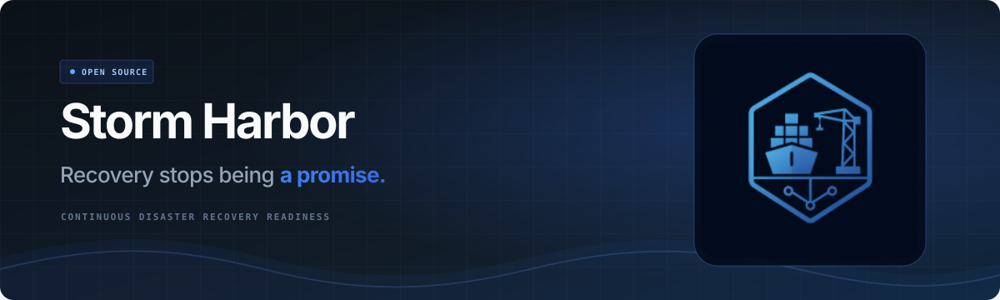

  

**Storm Harbor** is an independent, open-source recovery control plane for private projects and multicloud environments. Its goal is to turn versioned recovery intent into repeatable exercises, verified restores and auditable evidence.

[Website](https://stormharbor.io/) · [Getting Started](https://storm-harbor.github.io/storm-harbor-control-plane/getting-started/) · [English documentation](https://storm-harbor.github.io/storm-harbor-control-plane/) · [Roadmap](https://storm-harbor.github.io/storm-harbor-control-plane/roadmap/) · [Development issues](https://github.com/Storm-Harbor/storm-harbor-control-plane/issues)

## Your infrastructure. Your choices.

Organizations keep their repositories, infrastructure, credentials, knowledge and recovery evidence under their own control. Public project code and examples do not require customer projects to become public.

The provider-independent model targets **AWS, Azure, DigitalOcean, Oracle Cloud Infrastructure and GCP** through versioned adapters. Source-to-target compatibility must be verified for data, identity, networking and services. GCP is the first concrete target-design example; production cloud adapters are still being built.

The product website offers **25 language and regional options**, including right-to-left Arabic, Hebrew and Urdu. Technical documentation is maintained in **English**.

## A private, YAML-driven journey

The execution model being built uses a private central configuration repository and a GitHub App installed for selected repositories. Pinned **Go executors** will run in GitHub Actions on hosted runners or isolated customer-owned runners. A permanent agent or Kubernetes cluster is not required by the design.

**Configure → validate → discover → plan → approve → exercise or restore → verify → retain evidence.**

GitHub owns reviewed desired state. Cloud APIs, Terraform state backends, backup stores, vaults and evidence stores retain authority over their own data. Each approved run must freeze its configuration, source revisions and adapter/controller versions.

- **Scoped access:** organization/project authorization is established independently of YAML.
- **External secrets:** YAML contains logical references. Values and sensitive bindings stay in customer-controlled vaults, accessed through short-lived workload identity where supported.
- **Explicit recovery targets:** choose exercise or restore, create or reuse a target, and select environment/region placement. Exercise cleanup is limited to proven run-owned resources; retained restores have a different lifecycle.
- **Optional private AI/RAG/CLI:** projects choose their own integrations and retain their knowledge. AI cannot grant permissions or approve recovery.
- **Extensible resources and controllers:** custom kinds and Go controllers are planned, including native Kubernetes CRDs through an adapter.
- **Go 1.26.x:** the official runtime line for applications, APIs, controllers, agents, CLIs and SDKs.

Read the [YAML guide](https://storm-harbor.github.io/storm-harbor-control-plane/getting-started/yaml/), [policies and journey](https://storm-harbor.github.io/storm-harbor-control-plane/getting-started/policies-and-journey/), [GCP targets](https://storm-harbor.github.io/storm-harbor-control-plane/getting-started/gcp-targets/) and [external secrets design](https://storm-harbor.github.io/storm-harbor-control-plane/architecture/external-secrets/).

## What is available

| Component | Current boundary |
| --- | --- |
| Public website and English documentation | Published, with Getting Started, YAML examples, policies, journey and target guidance |
| Go recovery contracts | Implemented in source: strict bounded YAML/schema validation, trusted-scope matching, logical secret references and target lifecycle checks; no external operations |
| Safe simulations | Credential-free, GCP-shaped Node.js simulations; no cloud mutation |
| GitHub App, CLI/executor and identity/vault adapters | Planned runtime integrations |
| Production cloud recovery, continuous controllers and Kubernetes CRDs | Planned; support requires adapter-specific acceptance and isolated recovery evidence |

Offline configuration validation does not authenticate a caller, authorize a cloud operation or prove a service can recover. Runtime consumers must adopt validated, published immutable contract versions. See the [contract repository and release availability](https://github.com/Storm-Harbor/storm-lib-recovery-contracts) and the [roadmap](https://storm-harbor.github.io/storm-harbor-control-plane/roadmap/).

## Repositories and community

| Repository | Responsibility |
| --- | --- |
| [storm-harbor-control-plane](https://github.com/Storm-Harbor/storm-harbor-control-plane) | English documentation, architecture, adoption guides, schemas and safe simulations |
| [storm-lib-recovery-contracts](https://github.com/Storm-Harbor/storm-lib-recovery-contracts) | Shared Go configuration contracts, strict YAML validation and safe typed errors |
| [storm-harbor-app](https://github.com/Storm-Harbor/storm-harbor-app) | Static multilingual product website and transitional application scaffold |
| [.github](https://github.com/Storm-Harbor/.github) | Organization profile, engineering guidance, contribution and security policies, and funding information |

Start with the [contribution guide](https://github.com/Storm-Harbor/.github/blob/main/CONTRIBUTING.md), [maintainer roster](https://github.com/Storm-Harbor/.github/blob/main/MAINTAINERS.md) and [security policy](https://github.com/Storm-Harbor/.github/blob/main/SECURITY.md). Examples and contributions must use synthetic data and protect private repositories, knowledge and operational evidence.

[Funding information](https://storm-harbor.github.io/storm-harbor-control-plane/community/sponsorship/) · [CNCF readiness](https://storm-harbor.github.io/storm-harbor-control-plane/community/cncf-readiness/)

Open source under the [Apache License 2.0](https://github.com/Storm-Harbor/.github/blob/main/LICENSE).
